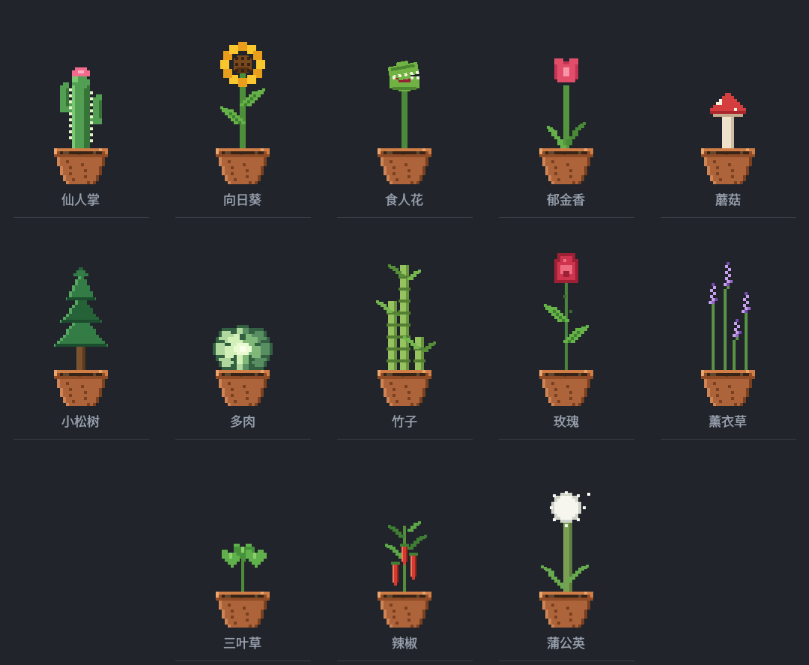

# 桌面电子盆栽 · Linux (Qt6)

把 Windows 上的桌面电子盆栽移植到 Linux/KDE 的版本。十三种像素风植物，带真实物理，能站在任意窗口的标题栏上。

**[下载最新版](https://github.com/Epiphany106-blip/taskbarplant-linux/releases/latest)** · [技术实现说明](TECHNICAL.md)

发布包有三个架构：`x86_64`、`aarch64`（ARMv8）、`armv7`（ARMv7）。i686 暂不提供预编译包，请从源码编译。



## 来源与致谢

本项目的**渲染逻辑、物理参数、像素画风全部来自 Ziyi Zhao 发起、DeepSeek 编写的 Windows 原版**：

**原版仓库 → [Ziyi-Zhao-star/TaskbarPlant](https://github.com/Ziyi-Zhao-star/TaskbarPlant)**

原版是纯 Win32 + GDI+，无第三方库。绘制完全基于 4px 网格吸附的离散色块和逐行栅格化的像素椭圆，物理是一套刚体模拟。移植时这些常数和公式被逐行照搬——重力 2400、弹跳系数 0.42、阻尼弹簧刚度 110、九种植物的每一块像素坐标和色值，都是原版的。

**这个移植版做的是平台适配**：把 GDI+ 的绘制翻译成 `QPainter::fillRect`，把 Win32 的分层窗口换成 X11 的 XShape，把 `EnumWindows` 换成 KWin 脚本桥。

原版在 Windows 上的设计（尤其是那些像素画的细节和手感）值得单独说一句：很好。

原版同样是 DeepSeek 写出来的。上游和下游都是 AI 写代码，人负责提要求、判断对不对。

## 特性

- **十三种植物**：仙人掌、向日葵、食人花、郁金香、蘑菇、小松树、多肉、竹子、玫瑰、薰衣草、三叶草、辣椒、蒲公英
- **会渴**：泥土水分随时间蒸发（默认 30 分钟干透），缺水后叶子从绿变枯黄，还会往下掉枯叶碎屑。右键「浇水」补回来，浇下的那一下植物会晃一下
- **单盆缩放**：每个花盆可以独立调大调小（0.65~1.45 倍），互不影响
- **导出图片**：右键可把当前这株导出成透明底 PNG
- **真实物理**：重力、地面碰撞、弹跳、旋转、拖拽甩出、落地扬尘、静止自动回正
- **只摸得到花**：花盆和植物之外的区域鼠标完全穿透，下层窗口照常操作
- **站在窗口上**：花盆能停在任意窗口的标题栏顶边，窗口移动、缩放时跟着走，窗口最小化时自然掉落
- **像素风**：没有抗锯齿、没有平滑矢量，所有边缘都是 4px 阶梯
- **淡出退出**：右键菜单退出时整个场景淡出

## 操作

| 操作 | 效果 |
| --- | --- |
| 拖动花盆 | 抓起来甩，松手时按甩出速度飞出去 |
| 拖动植物 | 茎被拉弯，松手回弹 |
| 右键 | 双列菜单：十三种植物切换（两列）+ 浇水 / 花盆调大 / 调小 / 放置 / 移除 / 导出 / 退出 |

右键点在空白处时，浇水、缩放、导出这些需要"当前花盆"的命令会灰掉。

## 技术要点

实现细节、平台层的坑、以及从原版继承并修掉的 bug，都在 **[TECHNICAL.md](TECHNICAL.md)**。

三句话版本：

- 点击穿透要自己设 XShape 的 `ShapeInput`，`setMask` 只管绘制不管输入
- Wayland 下拿不到其它窗口的位置，靠 KWin 脚本桥把 `frameGeometry` 推过来
- 花盆回正是弹簧 + 重心失稳，不是单纯的插值

## 构建

依赖：Qt6 (Widgets/Gui/DBus)、libX11、libXext、CMake ≥ 3.20、C++17

```bash
cmake -S . -B build -DCMAKE_BUILD_TYPE=Release
cmake --build build -j$(nproc)
```

openSUSE：

```bash
sudo zypper install gcc-c++ cmake qt6-base-devel libX11-devel libXext-devel
```

Debian/Ubuntu：

```bash
sudo apt install build-essential cmake qt6-base-dev libx11-dev libxext-dev
```

## 运行

```bash
./build/taskbarplant
```

单文件可执行，无需安装、无需启动脚本。首次运行会自己完成 KWin 脚本的安装与加载。

调试时加 `TBP_TRACE=1` 会把判定过程和花盆状态打到终端：

```bash
TBP_TRACE=1 ./build/taskbarplant
```

## 命令行参数

| 参数 | 默认 | 说明 |
| --- | --- | --- |
| `-u`, `--upright-delay <sec>` | `3` | 翻车后躺多久再自己爬起来（秒）。`0` 表示立刻回正 |
| `--scale <factor>` | `1.0` | 整体缩放。`1.0` 是原版比例，放大后像素颗粒会变粗 |
| `--dump-plants <path>` | — | 把十三种植物渲染成一张 PNG 后退出，用于生成展示图 |
| `--probe-menu` | — | 构建右键菜单但不弹出，输出尺寸后退出（无头测试用） |
| `-h`, `--help` | — | 显示帮助 |
| `-v`, `--version` | — | 显示版本 |

```bash
./build/taskbarplant --upright-delay 8     # 翻车了就多躺一会儿
./build/taskbarplant --scale 1.5           # 放大 1.5 倍
```

回正分三种情况，对应真实的稳定与失稳：

| 倾角 | 行为 |
| --- | --- |
| < 50° | 欠阻尼弹簧，像不倒翁。加速 → 冲过竖直位置 → 反向晃 → 收敛。过冲约 19%，周期约 1.1 秒 |
| 50° ~ 90° | 重心已越过底面边缘，拉不回来了。加速倒向侧躺，约 0.5 秒 |
| ≥ 90° | 摊着不动，攒够 `--upright-delay` 秒，再用过阻尼慢慢撑起来（约 3 秒），过程中不左右摇 |

临界角取 50°。按几何算，花盆宽 72、重心约在 24 高，理论临界角是 `atan(36/24) ≈ 56°`；取 50° 是为了让"摔倒"来得更干脆一点——手感比严格物理更重要。

真实的花盆斜过临界角就必定翻倒，不会自己站起来。这一点必须有，否则斜到 89° 还能立正，一眼假。

角度按 ±180° 归一化，所以转了 450° 和转了 90° 是一回事。

## 环境变量

| 变量 | 作用 |
| --- | --- |
| `TBP_TRACE=1` | 输出承托判定与花盆状态日志 |
| `TBP_SCALE=1.5` | 同 `--scale`（命令行优先） |
| `TBP_PLATFORM=wayland` | 强制原生 Wayland 后端（会失去点击穿透和窗口承托） |
| `TBP_POT_X` / `TBP_POT_Y` | 指定初始花盆位置，用于调试 |
| `TBP_WILT=0.8` | 配合 `--dump-plants`，强制指定枯萎程度，用于检查枯叶配色 |

## 已知限制

- **只在 KDE Plasma 下能站在窗口上**。靠 KWin 脚本桥实现，其它桌面环境会退回 X11 枚举，只能看到 XWayland 窗口，再不行就只停屏幕底边。
- 点击穿透依赖 X11 的 XShape，所以程序强制走 `xcb` 后端（KDE 下即 XWayland）。原生 Wayland 下无法实现。
- 窗口被其它窗口完全遮住时，花盆仍会停在被遮住那个窗口的标题栏上。
- 花盆状态只存在内存里，重启后回到一个向日葵。
- 原版的「全屏应用时自动隐藏」没有移植，Linux 下没有可靠的全屏检测接口。
- **上游 v3.5 的「编辑模式」没有移植**：其余（十三种植物、双列菜单、浇水、干枯、单盆缩放、导出图片）都已同步。

## 开发说明

三方协作，各司其职：

- **Ziyi Zhao** — Windows 原版 [TaskbarPlant](https://github.com/Ziyi-Zhao-star/TaskbarPlant) 的发起人。项目方向、像素画、物理手感都由他提出，代码由 DeepSeek 编写。已授权发布本移植版。
- **Zirui Liu** — Linux 移植版的发起人。提需求、定方向、做测试反馈。点击穿透、跟随窗口、残影、停在屏幕中间这些问题，都是他一个个测出来的。
- **DeepSeek V4.1 Flash 1017**（运行在 WorkBuddy 中）— 编写移植版代码并调试。平台层的坑（XShape 输入区域、KWin 脚本桥、D-Bus 接口名）大部分是靠它用 `busctl` / `xprop` 排查跑通的。

两个项目的代码都由 AI 编写，人负责提出要什么、判断对不对。这不是要淡化谁的贡献——方向错了代码再好也没用，但写代码这件事确实不是人做的。

原版只用 Win32 + GDI+，没有任何第三方库。移植版保留了同样的克制：只用 Qt6 做绘制、X11 做点击穿透、KWin 脚本拿窗口位置，除此之外没有运行时依赖。

## 许可

MIT，见 [LICENSE](LICENSE)。

这意味着你可以自由使用、修改、分发、商用，唯一要求是保留版权与许可声明。原版 `TaskbarPlant` 由 Ziyi Zhao 发起、DeepSeek 编写，已授权本仓库改编为 Linux 移植版本。
